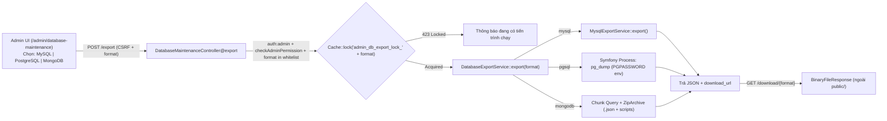

# PLAYBOOK: XUẤT DATABASE ĐA ĐỊNH DẠNG 1-CLICK TRONG ADMIN (MYSQL / POSTGRESQL / MONGODB)

> **Tài liệu chuẩn kiến trúc & quy trình triển khai (Architectural Playbook)**  
> **Dự án chuẩn mẫu:** `vattunongnghiep58` (Laravel 13 + PostgreSQL 16 + AdminLTE 4)  
> **Trạng thái:** Đã hoàn thành & Kiểm thử 100% (14/14 PHPUnit tests passed + Live Export Verified)  
> **Ngày lập:** 2026-11-21

---

## 1. MỤC TIÊU & PHẠM VI

Nâng cấp khối **Xuất Database** trong trang **Bảo trì CSDL** (`/admin/database-maintenance`) từ xuất đơn định dạng MySQL lên **3 định dạng chuẩn công nghiệp**:

| Định dạng (`format`) | Cơ chế sinh file | File đầu ra | Cách import thực tế |
| :--- | :--- | :--- | :--- |
| **`mysql`** | `MysqlExportService` (`db:sync-to-mysql` + `mysqldump`) | `*.sql` (`ENGINE=InnoDB`, `utf8mb4`) | Import thẳng vào phpMyAdmin / HeidiSQL / cPanel |
| **`pgsql`** | `pg_dump --format=p --encoding=UTF8 --no-owner` (truyền `PGPASSWORD` qua env) | `*.sql` (Plain SQL chuẩn PostgreSQL 16) | Import qua `psql -f` hoặc DBeaver / pgAdmin Restore |
| **`mongodb`** | Đọc chunk 500 dòng từ PostgreSQL, ép kiểu `JSONB` → object thật, đóng gói `ZipArchive` | `*.zip` (gồm `<table_name>.json` + `import_mongodb.bat/.sh` + `README_IMPORT_MONGODB.md`) | Giải nén rồi import bằng MongoDB Compass hoặc chạy `import_mongodb.bat` / `.sh` (`mongoimport --jsonArray`) |

---

## 2. KIẾN TRÚC & BẢO MẬT

### Guardrails bắt buộc
1. **Whitelist nghiêm ngặt:** Chỉ chấp nhận `format` thuộc `['mysql', 'pgsql', 'mongodb']` ở cả Route (`whereIn`) lẫn Controller Validation.
2. **File lưu ngoài Webroot:** Lưu tại `storage/app/private/db-exports/` (riêng `mysql` tái sử dụng `database/vattunongnghiep58_mysql_latest.sql`). Không bao giờ đặt file dump trong `public/`.
3. **Không lộ mật khẩu trên CLI:** `pg_dump` truyền mật khẩu qua biến môi trường `PGPASSWORD` của `Symfony\Component\Process\Process`, không gắn lên command string.
4. **Khóa song song theo từng định dạng:** `Cache::lock("admin_db_export_lock_{$format}", 180)`.
5. **Tương thích ngược 100%:** Giữ nguyên các route cũ `/export-mysql`, `/download-mysql`, CLI `php artisan db:sync-to-mysql` và `export_mysql.bat`.

---

## 3. DANH SÁCH FILE TRIỂN KHAI

1. **`app/Services/DatabaseExportService.php`**: Service trung tâm quản lý trạng thái, đường dẫn, và thực thi xuất cho cả 3 định dạng (`mysql`, `pgsql`, `mongodb`).
2. **`routes/admin.php`**: Đăng ký `POST /admin/database-maintenance/export` và `GET /admin/database-maintenance/download/{format}`.
3. **`app/Http/Controllers/Admin/DatabaseMaintenanceController.php`**: Thêm `export(Request)` và `download(Request, string)` dùng `DatabaseExportService`.
4. **`resources/views/backend/setting/database-maintenance.blade.php`**: Nâng cấp Card xuất DB với 3 thẻ chọn định dạng trực quan, trạng thái sẵn sàng, metadata bản xuất gần nhất theo từng định dạng, nút xuất 1-Click + Toast góc trên bên phải.
5. **`tests/Feature/Admin/DatabaseMultiExportTest.php`**: Kiểm thử tự động đầy đủ cho cả 3 định dạng (phân quyền, validate format sai, lock 423, export & download từng định dạng, test tích hợp thật với MongoDB ZIP generator).
6. **`e:\web\note\AI_DB_MULTI_EXPORT_BLUEPRINT.md`**: Blueprint tổng quát để AI có thể nhân rộng sang bất kỳ dự án Laravel nào khác.
