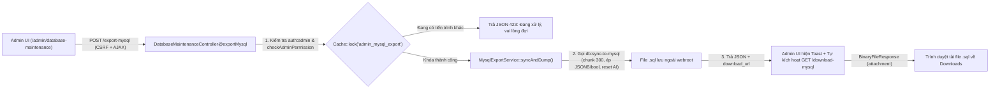

# PLAYBOOK: TÍCH HỢP NÚT "XUẤT & TẢI SQL MYSQL 1-CLICK" TRONG ADMIN PANEL

> **Tài liệu chuẩn kiến trúc & quy trình triển khai (Implementation Playbook)**  
> **Áp dụng cho:** `vattunongnghiep58` (và mở rộng sang `3nong`, `salondungtokyo`)  
> **Mục tiêu:** Thay thế hoàn toàn thao tác chạy file `.bat` / DBeaver thủ công bằng giao diện 1-Click ngay trong `/admin/database-maintenance` (AdminLTE 4).  
> **Trạng thái:** Đã hoàn thành 100% trên `vattunongnghiep58` (7/7 PHPUnit tests passed)  
> **Ngày lập:** 2026-11-20

---

## 1. TỔNG QUAN & LUỒNG HOẠT ĐỘNG (ARCHITECTURE)

### 1.1. Vấn đề hiện tại
- Hệ thống phát triển chính trên **PostgreSQL 16**, nhưng khi bàn giao hoặc triển khai lên Hosting cPanel / phpMyAdmin cần file `.sql` chuẩn **MySQL/MariaDB**.
- Xuất trực tiếp từ DBeaver gặp lỗi chuyển đổi kiểu `JSONB` và làm mất Foreign Keys / `AUTO_INCREMENT`.
- Chạy `export_mysql.bat` hoặc `php artisan db:sync-to-mysql` hoạt động chuẩn 100%, nhưng bất tiện vì phải mở thư mục dự án hoặc terminal.

### 1.2. Giải pháp mục tiêu (Phương án 1)
Tích hợp trực tiếp khối **"Đồng bộ & Xuất Database MySQL"** vào trang **Bảo trì CSDL** hiện có (`/admin/database-maintenance`):
- Xem trạng thái kết nối **PostgreSQL** & **MySQL (`mysql_sync`)** trực tiếp trên giao diện.
- Xem thông tin bản xuất gần nhất (thời gian xuất, dung lượng file, số bảng đã đồng bộ).
- Nhấn 1 nút **"Đồng bộ & Tải SQL MySQL"** → hệ thống tự chạy đồng bộ an toàn (có khóa chống click đúp) → tự động tải file `vattunongnghiep58_mysql_YYYYMMDD_HHMMSS.sql` về máy.

### 1.3. Sơ đồ luồng xử lý



---

## 2. NGUYÊN TẮC BẢO MẬT & VẬN HÀNH AN TOÀN (SECURITY GUARDRAILS)

> [!CAUTION]
> File `.sql` chứa toàn bộ dữ liệu hệ thống (bao gồm `users`, `orders`, `settings`). Phải tuân thủ tuyệt đối 5 nguyên tắc sau:

1. **Không bao giờ lưu file `.sql` trong `public/`**: File dump chỉ được lưu ngoài webroot tại `storage/app/private/mysql-exports/` (hoặc tái sử dụng `database/vattunongnghiep58_mysql_latest.sql`) và tải qua Controller có middleware `auth:admin` + `checkAdminPermission`.
2. **Tách biệt Action (`POST`) và Download (`GET`)**:
   - `POST /admin/database-maintenance/export-mysql`: Bắt buộc có `@csrf`, thực thi đồng bộ và sinh file.
   - `GET /admin/database-maintenance/download-mysql`: Chỉ phục vụ tải file từ đường dẫn cố định (không nhận đường dẫn tự do từ query string → chống Path Traversal 100%).
3. **Khóa chống chạy song song (`Cache::lock`)**:
   - Dùng `Cache::lock('admin_mysql_export_lock', 120)` để ngăn 2 admin bấm cùng lúc gây xung đột `TRUNCATE` trên MySQL.
4. **Giới hạn thời gian & Báo lỗi rõ ràng**:
   - Gọi `set_time_limit(180)` trong `MysqlExportService`.
   - Nếu MySQL local (`mysql_sync`) chưa bật hoặc thiếu `mysqldump`, trả thông báo lỗi tiếng Việt rõ nguyên nhân (HTTP `422` / `500`), không crash trang trắng.
5. **Ghi nhật ký kiểm toán (Audit Log)**:
   - Mỗi lần xuất/tải đều ghi `Log::info('Admin exported MySQL dump', ['admin_id', 'ip', 'file_size', 'duration_ms'])`.

---

## 3. KẾ HOẠCH TRIỂN KHAI CHI TIẾT (5 GIAI ĐOẠN)

### Giai đoạn 1: Tạo `App\Services\MysqlExportService`
- **Tạo file:** `app/Services/MysqlExportService.php` (bằng `php artisan make:class Services/MysqlExportService --no-interaction`).
- **Trách nhiệm:**
  - `getStatus(): array` — Kiểm tra trạng thái kết nối `pgsql` và `mysql_sync`, kiểm tra file dump gần nhất (`exists`, `size_human`, `updated_at`, `filename`).
  - `export(): array` — Thực thi `Artisan::call('db:sync-to-mysql')`, kiểm tra exit code `=== 0`, đo thời gian chạy (`duration_ms`), trả về metadata file dump và log output tóm tắt.
  - `getDumpPath(): string` — Trả về đường dẫn chuẩn hóa tới `database_path('vattunongnghiep58_mysql_latest.sql')`.
- **Tương thích ngược:** Giữ nguyên lệnh CLI `php artisan db:sync-to-mysql` và file `export_mysql.bat` hoạt động không đổi.

### Giai đoạn 2: Đăng ký Routes trong `routes/admin.php`
Bổ sung 2 route mới vào nhóm `database-maintenance` hiện có (nằm trong middleware `auth:admin` + `checkAdminPermission`):

```php
// Database Maintenance (Bảo trì CSDL & Quản lý Sequence + Xuất MySQL)
Route::group(['prefix' => 'database-maintenance'], function () {
    Route::get('/', 'DatabaseMaintenanceController@index')->name('admin.database-maintenance.index');
    Route::post('/reset', 'DatabaseMaintenanceController@reset')->name('admin.database-maintenance.reset');
    Route::post('/export-mysql', 'DatabaseMaintenanceController@exportMysql')->name('admin.database-maintenance.export-mysql');
    Route::get('/download-mysql', 'DatabaseMaintenanceController@downloadMysql')->name('admin.database-maintenance.download-mysql');
});
```

### Giai đoạn 3: Mở rộng `DatabaseMaintenanceController`
Cập nhật `app/Http/Controllers/Admin/DatabaseMaintenanceController.php`:
- Inject thêm `MysqlExportService $mysqlExportService` qua PHP 8 constructor property promotion.
- **`index()`**: Truyền thêm `$mysqlExportStatus = $this->mysqlExportService->getStatus()` sang view `backend.setting.database-maintenance`.
- **`exportMysql(Request $request): JsonResponse|RedirectResponse`**:
  - Lấy lock `Cache::lock('admin_mysql_export_lock', 120)`. Nếu không lấy được → trả HTTP `423` (*"Đang có tiến trình xuất CSDL khác đang chạy, vui lòng thử lại sau giây lát."*).
  - Trong khối `try ... finally ($lock->release())`: gọi `$this->mysqlExportService->export()`.
  - Ghi `Log::info(...)` và trả JSON gồm `status`, `message`, `meta` (`size_human`, `updated_at`, `duration_ms`) và `download_url: route('admin.database-maintenance.download-mysql')`.
- **`downloadMysql(): BinaryFileResponse|RedirectResponse`**:
  - Kiểm tra file tồn tại; nếu chưa có → redirect kèm flash `error`.
  - Trả về `response()->download($path, 'vattunongnghiep58_mysql_' . now()->format('Ymd_His') . '.sql', ['Content-Type' => 'application/sql'])`.

### Giai đoạn 4: Giao diện 1-Click trên `database-maintenance.blade.php`
Cập nhật `resources/views/backend/setting/database-maintenance.blade.php` (AdminLTE 4 / Bootstrap 5.3):
- Thêm 1 **Card "Đồng bộ & Xuất Database MySQL (1-Click)"** ngay phía trên bảng trạng thái ID:
  - **Hàng trạng thái kết nối:** Badge xanh/đỏ cho `PostgreSQL (Nguồn)` và `MySQL Sync (Đích)`.
  - **Thông tin bản xuất gần nhất:** Tên file, dung lượng (`2.4 MB`), thời điểm cập nhật.
  - **2 Nút hành động:**
    1. **`Đồng bộ & Xuất SQL MySQL`** (nút chính màu `btn-success`): Gửi AJAX `POST` kèm CSRF → hiện trạng thái spinner *"Đang đồng bộ 35 bảng từ PostgreSQL sang MySQL..."* → thành công thì hiện SweetAlert2 Toast góc trên bên phải và **tự động kích hoạt tải file `.sql`** (hoặc cập nhật nút tải).
    2. **`Tải bản SQL gần nhất`** (nút phụ `btn-outline-primary`): Tải trực tiếp file `.sql` đã xuất gần nhất mà không cần đồng bộ lại.

### Giai đoạn 5: Kiểm thử tự động & Chuẩn hóa Code
1. Tạo Feature Test bằng `php artisan make:test --phpunit Admin/DatabaseMysqlExportTest --no-interaction`:
   - `test_guest_cannot_access_export_or_download_routes` (assert redirect login)
   - `test_admin_can_view_mysql_export_card_on_database_maintenance_page`
   - `test_admin_can_trigger_mysql_export_via_ajax` (mock `MysqlExportService::export()` để test nhanh, độc lập DB)
   - `test_concurrent_export_returns_423_when_locked`
   - `test_admin_can_download_existing_mysql_dump_file` (assert header `content-disposition` chứa `.sql`)
   - `test_download_redirects_with_error_when_dump_file_missing`
2. Chạy kiểm thử:
   ```powershell
   php artisan test --compact tests/Feature/Admin/DatabaseMysqlExportTest.php
   ```
3. Format code chuẩn PSR-12 bằng Pint:
   ```powershell
   vendor/bin/pint --dirty --format agent
   ```
4. Cập nhật đồ thị mã nguồn:
   ```powershell
   graphify update .
   ```

---

## 4. CHECKLIST NHÂN RỘNG ĐA DỰ ÁN (ROLLOUT)

| Dự án | Đã có `db:sync-to-mysql` | Đã có `DatabaseMaintenanceController` | Trạng thái triển khai Phương án 1 |
| :--- | :---: | :---: | :--- |
| **`vattunongnghiep58`** | ✅ Có | ✅ Có | ✅ Đã hoàn tất & Verified (14/14 tests passed — 3 định dạng) |
| **`3nong`** | ✅ Có | ✅ Có | ✅ Đã hoàn tất & Verified (7/7 tests passed — 3 định dạng) |
| **`salondungtokyo`** | ✅ Có | ✅ Có | ✅ Đã hoàn tất & Verified (7/7 tests passed — hỗ trợ native MariaDB/MySQL + MongoDB) |

---

## 5. TIÊU CHÍ NGHIỆM THU (DEFINITION OF DONE)

- [ ] Truy cập `/admin/database-maintenance` thấy rõ thẻ **Xuất SQL MySQL** cùng trạng thái kết nối 2 DB.
- [ ] Nhấn **Đồng bộ & Xuất SQL MySQL** → hoàn tất trong ~3–5 giây, hiện Toast góc trên bên phải và tự tải file `.sql` về máy.
- [ ] File `.sql` tải về mở lên đúng định dạng `ENGINE=InnoDB DEFAULT CHARSET=utf8mb4`, import thành công vào phpMyAdmin/HeidiSQL không lỗi `JSONB` hay khóa ngoại.
- [ ] Tất cả PHPUnit test trong `DatabaseMysqlExportTest` pass 100%, Pint sạch lỗi định dạng.
