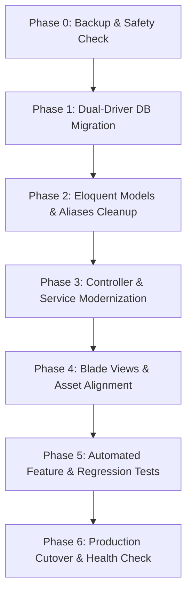

# PLAYBOOK: TÁI CẤU TRÚC CHUẨN HÓA SCHEMA ĐƠN HÀNG (ORDERS REFACTORING PLAYBOOK)

> **Tài liệu chuẩn kiến trúc & quy trình thực thi (Architectural Playbook)**  
> **Áp dụng cho:** Hệ thống E-commerce Laravel (`vattunongnghiep58`, `3nong`, và các dự án mở rộng)  
> **Trạng thái:** Đã hoàn thành 100% trên `vattunongnghiep58` (Completed & Verified)  
> **Tác giả:** Senior Software Architect & Database Specialist  
> **Phiên bản:** 1.0.0 (Ngày hoàn tất: 2026-10-22)

---

## 1. TỔNG QUAN KIẾN TRÚC & MỤC TIÊU (EXECUTIVE SUMMARY)

### 1.1. Hiện trạng kiến trúc cũ (Legacy State)
- **Tên bảng:** `shop_orders` (tiền thân từ bảng `addtocard`).
- **Khóa chính:** `cart_id` (gây cấn và lệch pha so với quy ước mặc định `id` của Laravel).
- **Bảng chi tiết:** `shop_order_items` (khóa ngoại `cart_id`).
- **Tên cột dữ liệu:** Mang nặng tiền tố giỏ hàng: `cart_total`, `cart_status`, `cart_payment`, `cart_code`, `cart_phone`, `cart_email`, `cart_address`, `cart_note`...
- **Model:** Phải khai báo thủ công `protected $table = 'shop_orders';` và `protected $primaryKey = 'cart_id';`, tồn tại các alias kế thừa lịch sử như `Addtocard`, `Addtocard_Detail`.

### 1.2. Trạng thái mục tiêu (Target State — Chuẩn Eloquent Conventions)
- **Tên bảng:** `orders` (tự động ánh xạ với Model `Order`, không cần `$table`).
- **Khóa chính:** `id` (tự động ánh xạ chuẩn Eloquent, không cần `$primaryKey`).
- **Bảng chi tiết:** `order_items` (khóa chính `id`, khóa ngoại `order_id` trỏ đến `orders.id` với `ON DELETE CASCADE`).
- **Tên cột dữ liệu:** Tinh gọn, chuẩn quốc tế:
  - `cart_total` ➔ `total`
  - `cart_status` ➔ `status` (hoặc `order_status`)
  - `cart_payment` ➔ `payment_status`
  - `cart_code` ➔ `code` (hoặc `order_code`)
  - `cart_phone` ➔ `phone`
  - `cart_email` ➔ `email`
  - `cart_address` ➔ `address`
  - `cart_note` ➔ `note`
- **Tương thích:** Vận hành mượt mà 100% trên cả **PostgreSQL 16** (Local/VPS) và **MySQL 8.x / MariaDB** (Production/Hosting).

---

## 2. MA TRẬN ĐỐI CHIẾU THAY ĐỔI (SCHEMA MAPPING MATRIX)

| Bảng cũ | Cột cũ | Bảng mới | Cột mới | Kiểu dữ liệu | Ràng buộc / Index |
| :--- | :--- | :--- | :--- | :--- | :--- |
| `shop_orders` | **`cart_id`** | **`orders`** | **`id`** | BIGINT / SERIAL | **PRIMARY KEY** |
| `shop_orders` | `cart_code` | `orders` | `code` | VARCHAR(100) | INDEX |
| `shop_orders` | `cart_phone` | `orders` | `phone` | VARCHAR(50) | INDEX |
| `shop_orders` | `cart_email` | `orders` | `email` | VARCHAR(300) | INDEX |
| `shop_orders` | `cart_address` | `orders` | `address` | TEXT | NULLABLE |
| `shop_orders` | `cart_note` | `orders` | `note` | TEXT | NULLABLE |
| `shop_orders` | `cart_total` | `orders` | `total` | DOUBLE / DECIMAL | NOT NULL |
| `shop_orders` | `cart_status` | `orders` | `status` | BOOLEAN / INT | DEFAULT 0 |
| `shop_orders` | `cart_payment` | `orders` | `payment_status` | INTEGER | DEFAULT 0 |
| `shop_orders` | `user_id` | `orders` | `user_id` | BIGINT | FK ➔ `users(id)` ON DELETE SET NULL |
| `shop_order_items` | `id` | **`order_items`** | `id` | BIGINT / SERIAL | **PRIMARY KEY** |
| `shop_order_items` | **`cart_id`** | `order_items` | **`order_id`** | BIGINT | **FK ➔ `orders(id)` ON DELETE CASCADE** |
| `shop_order_items` | `product_id` | `order_items` | `product_id` | BIGINT | FK ➔ `products(id)` |
| `shop_order_items` | `price` | `order_items` | `price` | DECIMAL(20, 6) | NOT NULL |
| `shop_order_items` | `quanlity` | `order_items` | `quantity` *(sửa lỗi typo)* | INTEGER | NOT NULL |

---

## 3. LỘ TRÌNH TRIỂN KHAI TỪNG GIAI ĐOẠN (EXECUTION PHASES)



---

### PHASE 0: SAU LƯU DỮ LIỆU & KIỂM TRA TOÀN VẸN (PRE-FLIGHT AUDIT)

- [x] **Bước 0.1: Chụp ảnh dữ liệu hiện tại (Snapshot & Backup):**
  - **Trên PostgreSQL:**
    ```bash
    pg_dump -U postgres -h 127.0.0.1 -d {database_name} -t shop_orders -t shop_order_items > database/backup_orders_pre_refactor.sql
    ```
  - **Trên MySQL:**
    ```bash
    mysqldump -u {db_user} -p {database_name} shop_orders shop_order_items > database/backup_orders_pre_refactor.sql
    ```
- [x] **Bước 0.2: Xác minh số lượng bản ghi và quan hệ mồ côi (Integrity Check):**
  ```sql
  -- 1. Đếm tổng số đơn hàng và sản phẩm
  SELECT COUNT(*) FROM shop_orders;
  SELECT COUNT(*) FROM shop_order_items;

  -- 2. Kiểm tra xem có item nào mồ côi (cart_id không tồn tại trong shop_orders)
  SELECT i.id, i.cart_id 
  FROM shop_order_items i 
  LEFT JOIN shop_orders o ON i.cart_id = o.cart_id 
  WHERE o.cart_id IS NULL;
  ```
  *(Nếu có dòng mồ côi, phải xử lý dọn sạch trước khi tạo khóa ngoại mới).*

---

### PHASE 1: TẠO DATABASE MIGRATION ĐA NỀN TẢNG (DUAL-DRIVER MIGRATION)

Tạo file migration chuẩn: `database/migrations/YYYY_MM_DD_HHMMSS_refactor_shop_orders_to_orders_table.php`.

```php
<?php

use Illuminate\Database\Migrations\Migration;
use Illuminate\Database\Schema\Blueprint;
use Illuminate\Support\Facades\DB;
use Illuminate\Support\Facades\Schema;

return new class extends Migration
{
    public function up(): void
    {
        $driver = DB::connection()->getDriverName();

        // 1. Gỡ bỏ Foreign Key cũ
        Schema::table('shop_order_items', function (Blueprint $table) {
            $table->dropForeign(['cart_id']);
        });

        if (Schema::hasTable('shop_orders')) {
            Schema::table('shop_orders', function (Blueprint $table) {
                // Gỡ FK user_id nếu có
                try {
                    $table->dropForeign(['user_id']);
                } catch (\Throwable $e) {}
            });
        }

        // 2. Đổi tên cột trong shop_orders trước khi đổi tên bảng
        Schema::table('shop_orders', function (Blueprint $table) {
            $table->renameColumn('cart_id', 'id');
            $table->renameColumn('cart_code', 'code');
            $table->renameColumn('cart_phone', 'phone');
            $table->renameColumn('cart_email', 'email');
            $table->renameColumn('cart_address', 'address');
            $table->renameColumn('cart_note', 'note');
            $table->renameColumn('cart_total', 'total');
            $table->renameColumn('cart_status', 'status');
            $table->renameColumn('cart_payment', 'payment_status');
        });

        // 3. Đổi tên cột trong shop_order_items
        Schema::table('shop_order_items', function (Blueprint $table) {
            $table->renameColumn('cart_id', 'order_id');
            if (Schema::hasColumn('shop_order_items', 'quanlity')) {
                $table->renameColumn('quanlity', 'quantity');
            }
        });

        // 4. Đổi tên bảng
        Schema::rename('shop_orders', 'orders');
        Schema::rename('shop_order_items', 'order_items');

        // 5. Đồng bộ Sequence (Nếu dùng PostgreSQL)
        if ($driver === 'pgsql') {
            // Đổi tên sequence mặc định cho khớp tên bảng mới
            DB::statement('ALTER SEQUENCE IF EXISTS shop_orders_cart_id_seq RENAME TO orders_id_seq');
            DB::statement('ALTER SEQUENCE IF EXISTS shop_order_items_id_seq RENAME TO order_items_id_seq');
        }

        // 6. Tái tạo Khóa ngoại chuẩn
        Schema::table('orders', function (Blueprint $table) {
            $table->foreign('user_id')->references('id')->on('users')->nullOnDelete();
        });

        Schema::table('order_items', function (Blueprint $table) {
            $table->foreign('order_id')->references('id')->on('orders')->cascadeOnDelete();
        });
    }

    public function down(): void
    {
        $driver = DB::connection()->getDriverName();

        // 1. Gỡ FK mới
        Schema::table('order_items', function (Blueprint $table) {
            $table->dropForeign(['order_id']);
        });

        Schema::table('orders', function (Blueprint $table) {
            try {
                $table->dropForeign(['user_id']);
            } catch (\Throwable $e) {}
        });

        // 2. Đổi lại tên bảng
        Schema::rename('orders', 'shop_orders');
        Schema::rename('order_items', 'shop_order_items');

        // 3. Đổi lại tên cột
        Schema::table('shop_orders', function (Blueprint $table) {
            $table->renameColumn('id', 'cart_id');
            $table->renameColumn('code', 'cart_code');
            $table->renameColumn('phone', 'cart_phone');
            $table->renameColumn('email', 'cart_email');
            $table->renameColumn('address', 'cart_address');
            $table->renameColumn('note', 'cart_note');
            $table->renameColumn('total', 'cart_total');
            $table->renameColumn('status', 'cart_status');
            $table->renameColumn('payment_status', 'cart_payment');
        });

        Schema::table('shop_order_items', function (Blueprint $table) {
            $table->renameColumn('order_id', 'cart_id');
            if (Schema::hasColumn('shop_order_items', 'quantity')) {
                $table->renameColumn('quantity', 'quanlity');
            }
        });

        if ($driver === 'pgsql') {
            DB::statement('ALTER SEQUENCE IF EXISTS orders_id_seq RENAME TO shop_orders_cart_id_seq');
            DB::statement('ALTER SEQUENCE IF EXISTS order_items_id_seq RENAME TO shop_order_items_id_seq');
        }

        // 4. Khôi phục lại FK cũ
        Schema::table('shop_orders', function (Blueprint $table) {
            $table->foreign('user_id')->references('id')->on('users')->nullOnDelete();
        });

        Schema::table('shop_order_items', function (Blueprint $table) {
            $table->foreign('cart_id')->references('cart_id')->on('shop_orders')->cascadeOnDelete();
        });
    }
};
```

---

### PHASE 2: CẬP NHẬT TẦNG MODEL ELOQUENT & QUAN HỆ

- [x] **Cập nhật `App\Models\Backend\Order.php` & `App\Models\Frontend\Order.php`:**
  - **Xóa bỏ:** `protected $table = 'shop_orders';` (Laravel tự nhận diện `orders`).
  - **Xóa bỏ:** `protected $primaryKey = 'cart_id';` (Laravel tự nhận diện `id`).
  - **Cập nhật quan hệ:**
    ```php
    public function items(): HasMany
    {
        return $this->hasMany(OrderItem::class, 'order_id', 'id');
    }

    public function user(): BelongsTo
    {
        return $this->belongsTo(User::class, 'user_id', 'id');
    }
    ```
- [x] **Cập nhật `App\Models\Backend\OrderItem.php` & `App\Models\Frontend\OrderItem.php`:**
  - **Cập nhật quan hệ:**
    ```php
    public function order(): BelongsTo
    {
        return $this->belongsTo(Order::class, 'order_id', 'id');
    }
    ```
- [x] **Quản lý tương thích ngược cho Alias cũ (`Addtocard` & `Addtocard_Detail`):**
  - Giữ lại class kế thừa tạm thời kèm cảnh báo `@deprecated`:
    ```php
    /**
     * @deprecated Sử dụng App\Models\Frontend\Order thay thế.
     */
    class Addtocard extends Order {}
    ```

---

### PHASE 3: CẬP NHẬT CÁC CONTROLLER & SERVICES

- [x] **Bước 3.1: `CheckoutController.php`:**
  - Thay `cart_id` bằng `id`.
  - Thay `$order->cart_code` bằng `$order->code`.
  - Thay `cart_total`, `cart_status`, `cart_payment` bằng `total`, `status`, `payment_status`.
  - Lưu vào `order_items`: gán `'order_id' => $order->id`.
- [x] **Bước 3.2: `CustomerAccountService.php` & `CustomerController.php`:**
  - Đổi truy vấn: `->orderByDesc('id')` (thay vì `cart_id`).
  - Đổi tìm kiếm: `->where('id', $orderId)`.
  - Hàm liên kết đơn: `where('email', $user->email)->whereNull('user_id')->update(['user_id' => $user->id])`.
- [x] **Bước 3.3: `Admin\OrderController.php`:**
  - Đổi logic lấy chi tiết: `Order::with('items')->findOrFail($id)`.
  - Đổi bộ lọc và cập nhật trạng thái đơn hàng: sử dụng `status` và `payment_status`.
- [x] **Bước 3.4: `Admin\AjaxController.php`:**
  - Cập nhật hàm xóa nhanh: `Order::whereIn('id', $ids)->delete()`.
  - Cập nhật hàm đổi trạng thái nhanh: `$column == 'status' || $column == 'payment_status'`.
- [x] **Bước 3.5: `DatabaseMaintenanceService.php`:**
  - Cập nhật danh sách trắng `$supportedTables`:
    ```php
    protected array $supportedTables = [
        'products'        => 'id',
        'categories'      => 'id',
        'pages'           => 'id',
        'orders'          => 'id',          // Đã chuẩn hóa
        'order_items'     => 'id',          // Đã chuẩn hóa
        'contacts'        => 'id',
        ...
    ];
    ```

---

### PHASE 4: ĐỒNG BỘ GIAO DIỆN BLADE & ASSETS

- [x] **Giao diện Admin (`resources/views/backend/order/`):**
  - `index.blade.php`: Đổi các biến `$item->cart_id` ➔ `$item->id`, `$item->cart_code` ➔ `$item->code`, `$item->cart_status` ➔ `$item->status`.
  - `detail.blade.php`: Đổi các trường hiển thị thông tin người nhận, cước vận chuyển, danh sách bảng chi tiết (`$order->items`).
- [x] **Giao diện Khách hàng (`resources/views/frontend/`):**
  - `account/orders.blade.php`: Đổi link xem chi tiết: `route('account.orders.detail', $order->id)`.
  - `account/order_detail.blade.php`: Cập nhật hiển thị chi tiết mã đơn hàng và danh sách hàng hóa.
  - `pages/order_success.blade.php`: Cập nhật hiển thị mã đơn hàng `#{{ $order->code }}`.

---

### PHASE 5: TỰ ĐỘNG HÓA KIỂM THỬ (AUTOMATED TESTING)

Chạy bộ kiểm thử để đảm bảo mọi luồng hoạt động ổn định 100%:

- [x] **Kiểm thử Feature Đơn hàng (`tests/Feature/OrderManagementTest.php`):**
  - [x] Khách tạo đơn hàng mới ➔ Lưu vào `orders` và `order_items` thành công.
  - [x] Mã đơn hàng, tổng tiền, thông tin giao hàng lưu chính xác.
  - [x] Khách vào trang tài khoản xem được đúng đơn hàng của mình.
  - [x] Admin duyệt đơn, cập nhật trạng thái `status` và `payment_status` thành công.
  - [x] Xóa đơn hàng cha (`orders`) ➔ Các bản ghi con trong `order_items` tự động bị xóa sạch (Cascade Delete).
- [x] **Kiểm thử Bảo trì CSDL (`tests/Feature/DatabaseMaintenanceFeatureTest.php`):**
  - [x] Kiểm tra bảng `orders` xuất hiện trong dashboard với khóa chính `id`.
  - [x] Bấm "Đồng bộ ID" hoặc "Reset ID về 1" thành công không lỗi.

```bash
# Lệnh thực thi kiểm thử
php artisan test --filter=Order
php artisan test --filter=DatabaseMaintenance
```

---

### PHASE 6: KẾ HOẠCH BÀN GIAO & PHỤC HỒI SỰ CỐ (ROLLBACK PLAN)

#### Quy trình Go-Live an toàn:
1. Kích hoạt chế độ bảo trì: `php artisan down --secret="maintain-2026"`
2. Chạy lệnh sao lưu CSDL: `pg_dump` hoặc `mysqldump`
3. Chạy migration: `php artisan migrate --force`
4. Xóa toàn bộ cache: `php artisan optimize:clear`
5. Chạy test kiểm thử nhanh: `php artisan test --compact`
6. Mở lại website: `php artisan up`

#### Kịch bản khôi phục khẩn cấp (Nếu có sự cố):
1. Chạy rollback migration: `php artisan migrate:rollback --step=1`
2. Hoặc khôi phục file dump CSDL:
   ```bash
   # PostgreSQL
   psql -U postgres -d {database_name} < database/backup_orders_pre_refactor.sql
   # MySQL
   mysql -u {db_user} -p {database_name} < database/backup_orders_pre_refactor.sql
   ```
3. Checkout lại mã nguồn nhánh git trước đó: `git checkout HEAD~1`
4. Xóa cache và khởi động lại: `php artisan optimize:clear && php artisan up`

---

## 4. HƯỚNG DẪN TÁI SỬ DỤNG CHO CÁC DỰ ÁN KHÁC (REUSABILITY GUIDE)

Để áp dụng Playbook này cho các dự án tiếp theo (ví dụ: `3nong`, `salondungtokyo`):
1. Copy file `REFACTOR_ORDERS_SCHEMA_PLAYBOOK.md` vào thư mục `docs/` của dự án mục tiêu.
2. Kiểm tra tên bảng hiện tại trên dự án đó (`shop_orders` hay `addtocard` hay `orders`).
3. Thực hiện tuần tự theo Checklist từ **Phase 0** đến **Phase 6**.
4. Luôn tuân thủ nguyên tắc: **Không bao giờ sửa code trực tiếp trên Database thật khi chưa chạy Phase 0 (Backup & Safety Check)**.
